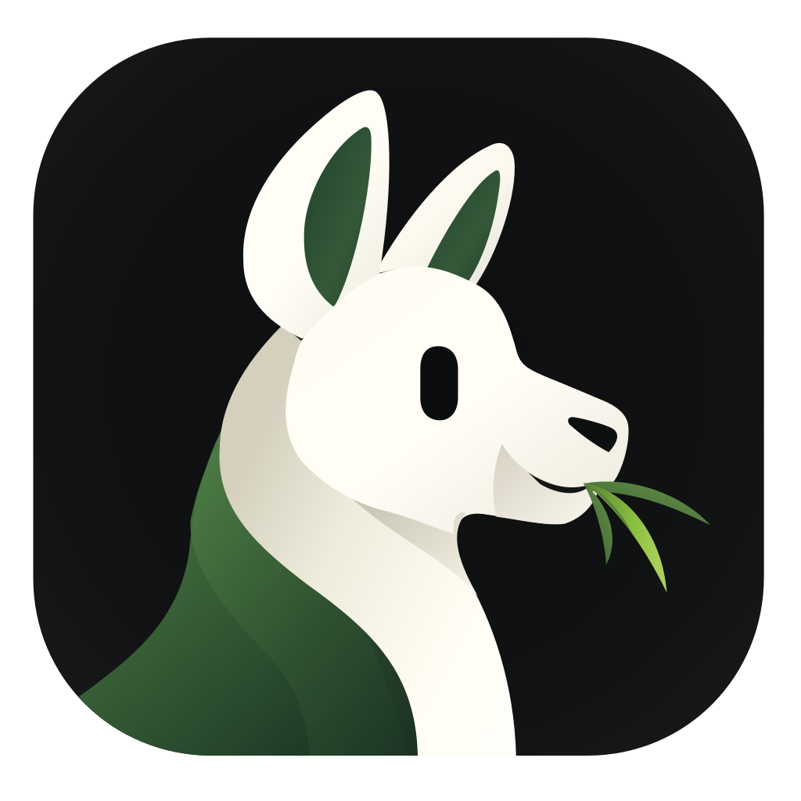

<p align="center">
  
</p>

# InstaLLM

[Source repository](https://github.com/PradyX/instaLLM) · Private AI. Fully on-device.

InstaLLM is a **privacy-first local AI assistant that runs entirely on your device**.
It enables **on-device Local Language Model (LLM) inference using GGUF models** with `llama_cpp_dart`, allowing you to chat with AI **without sending your data to external servers**.

Unlike most AI apps that rely on cloud APIs, **InstaLLM performs all inference locally on your phone or desktop**. Your prompts, conversations, and models remain **fully under your control**, making it suitable for users who value **privacy, offline capability, and ownership of their data**.

The app is designed as a **mobile-first local AI runtime** that now also supports desktop workflows, providing a smooth chat experience with model downloads, streaming responses, and per-model chat memory — all running directly **on-device**.

Because inference happens locally:

- No prompts leave your device
- No cloud processing is required
- No usage tracking of your conversations
- Works even without an internet connection (after models are downloaded)

InstaLLM brings **personal AI to your devices** — lightweight, private, and fully local.

<p align="center">
  
  
  
  
  
</p>

## Highlights

- Local inference with GGUF models (no server required for generation)
- **Vision Model Support**: Multimodal chat with image support (projector-based)
- **On-device Benchmarking**: Integrated `llmfit` to measure local performance
- Live token streaming in chat with `Thinking...` + progressive output
- Stop generation anytime
- **Multiple local conversations**: create, rename, search, pin and delete chats
- **Switch models inside a conversation** without losing chat history
- Per-message model attribution and generation stats
- Export/import conversations as versioned JSON (clipboard flow)
- Regenerate assistant reply + Edit & Resend user prompts
- Generation stats per assistant message (`tok/s`, elapsed time, token count, input tokens)
- Context usage readout above the composer (used vs. available input tokens, with a note when older messages were trimmed to fit)
- **Inference profiles**: Balanced, Battery Saver, Maximum Performance, or your own saved runtime configuration
- **Personas**: reusable system prompts (General, Coding, Research, Creative, Concise, or your own) chosen per conversation
- Markdown-like code fence rendering + one-tap copy for code blocks
- Adaptive generation mode for mobile performance tuning
- Sampling presets: `Precise`, `Balanced`, `Creative`
- Advanced override for `temperature` and `top-p`
- Built-in model catalog + custom model links
- Chunked/resumable downloads with progress + pause
- Local notification when a model download completes
- **macOS + Linux Desktop Support**: Desktop-ready local runtime and benchmarking flow

### Model Management

- **Model Search**: Quick filtering by name or parameter size
- Built-in model list (Qwen, Qwen Coder, Llama 3.2, SmolLM2, Gemma, Phi, TinyLlama)
- **HF Compatibility Detection**: Automatic detection of model capabilities
- Add custom models from direct `.gguf` URL
- Custom model validation:
  - URL required (`http/https`)
  - direct `.gguf` link required
  - model name required
  - parameter size required (format like `1.5B`, `800M`, `360M`)
- Sort models by parameter size
- Expand each model tile to inspect full metadata
- Select active downloaded model from toolbar dropdown

### Performance & Inference

- Mobile-focused context setup (`nCtx`/`nBatch` tuned for device class)
- Adaptive max-token behavior based on hardware + observed generation speed
- **Token-aware context**: the prompt is assembled against the loaded model's context window and output reservation, keeping the system prompt and the newest turns, and dropping older ones only when the budget runs out
- **Inference profiles**: context size, threads, GPU offload and sampling in one named configuration, applied to every model
- **Personas**: the system prompt lives with the conversation, not with the model, so the same chat history can switch voice without losing context
- GGUF signature checks to reject invalid/corrupt downloads

## Tech Stack

- Flutter + Material 3
- Riverpod (`flutter_riverpod`, `riverpod_annotation`)
- `llama_cpp_dart` for local LLM runtime
- Dio for model downloads (chunked + resumable)
- `flutter_secure_storage` for persisted app data, with Linux compatibility fallback when the system keyring is unavailable
- `flutter_local_notifications` for download-complete notifications
- GoRouter for navigation

## Project Structure

```text
lib/
├── main.dart
├── app.dart
├── core/
│   ├── navigation/app_router.dart
│   ├── services/
│   │   ├── llm_service.dart
│   │   ├── model_storage_service.dart
│   │   ├── storage_info_service.dart
│   │   └── local_notification_service.dart
│   ├── settings/inference_settings_provider.dart
│   └── theme/
├── features/
│   ├── about/
│   │   └── presentation/about_page.dart
│   ├── home/
│   │   ├── domain/chat_message.dart
│   │   └── presentation/
│   │       ├── home_page.dart
│   │       └── home_controller.dart
│   ├── model_selection/
│   │   ├── domain/llm_model.dart
│   │   └── presentation/
│   │       ├── model_selection_page.dart
│   │       ├── model_selection_controller.dart
│   │       └── model_selection_state.dart
│   └── settings/presentation/settings_page.dart
├── storage/secure_storage.dart
```

## Getting Started

### Prerequisites

- Flutter SDK `^3.10.8`
- Android Studio / Xcode / Linux desktop toolchain depending on your target platform

For Linux desktop development, enable the Flutter desktop target and install the Linux build dependencies that Flutter, `flutter_secure_storage`, and the desktop shell need. On Debian/Ubuntu-based systems, a typical setup is:

```bash
flutter config --enable-linux-desktop
sudo apt install clang cmake ninja-build pkg-config libgtk-3-dev libsecret-1-dev libjsoncpp-dev
```

If you also want the bundled Linux benchmark CLI, install Rust with `rustup` as well.

### Setup

```bash
# 1) Install dependencies
flutter pub get

# 2) Ensure env file exists (required by startup)
cp .env.example .env

# 3) Run app for your target platform
flutter run -d android
# or
flutter run -d macos
# or
flutter run -d linux
```

On macOS, prefer `scripts/run_macos.sh` over a bare `flutter run -d macos`: it renews the development provisioning profile, which Apple issues for only seven days on a free Personal Team and which the Flutter macOS builder cannot renew on its own. See [scripts/run_macos.sh](scripts/run_macos.sh) for the details and flags.

For Linux-specific native runtime, benchmark asset, and installable release archive steps, see [scripts/BUILD_LINUX.md](scripts/BUILD_LINUX.md).

### If you change Riverpod annotations

```bash
dart run build_runner build --delete-conflicting-outputs
```

## How To Use

1. Open **Model Selection** from drawer.
2. Download a built-in model or add your own GGUF link.
3. Select a downloaded model.
4. Start chatting on Home.
5. Use `Stop`, `Regenerate`, or `Edit & Resend` for quick iteration.

### Appearance

Settings offers independent **Auto / Light / Dark**, **Solid / Translucent**, and **Accent colour** controls. Translucent uses frosted panels over an in-app background. Green is the default accent; Blue, Purple, Teal, Pink, Orange, Red and Amber are also available. Surface and accent choices are stored locally and restored on restart.

### Conversations

The same compact navigation panel stays open beside the chat on wide screens and opens from the hamburger on mobile. Its workspace header opens a dropdown for switching or managing workspaces. Models, Benchmark and Settings use three shortcut tiles, followed by one search/New chat bar and separate Chats, Bots and Rooms lists. Rows show a single title line, with an accent stripe on the selected chat; profile images and needs-you badges remain visible. Every pinned chat and the five newest others stay in the sidebar, with the rest behind See all. Board stays at the bottom, and About is available in Settings.

Settings uses spacing between its controls without divider lines. Settings → Voice offers Device recognition and offline Whisper for composer dictation. Whisper is the default; older GGUF speech-engine selections resolve to Whisper while preserving saved model and read-aloud choices. Device recognition remains an explicit choice because the OS may process audio on its vendor's servers.

- Tap the **new chat** icon on Home to start a conversation.
- Open **Conversations** in the drawer to search, rename, pin, delete, export or import chats.
- Switching models inside a conversation keeps its history; every assistant reply records the model that generated it.
- Conversations are stored locally as versioned JSON (`conversations/` under the app support directory).
- Existing per-model chats from older versions are migrated into conversations automatically on first launch; the original secure-storage backup (`model_chat_threads_v1`) is left untouched.

### Context and memory

- Every request is assembled against a token budget derived from the model's context window, the tokens reserved for the answer and the safety margin; the system prompt always stays, and older turns are dropped oldest-first only when the budget runs out.
- The readout above the composer shows the input budget in use and says when older or shortened messages were trimmed to fit; tap it for the window and reservation details.
- Token counts are estimates (~4 characters per token plus per-message overhead) because the bundled runtime exposes no tokenizer, so the budget is kept conservative on purpose.

### Inference Profiles

- Open **Inference Profiles** in the drawer to see what the active profile resolves to on this device, and to switch between profiles.
- Built-ins: `Balanced` (app defaults), `Battery Saver` (1024 context, 2 threads, CPU only, short answers) and `Maximum Performance` (8192 context, full GPU offload, longer answers). Built-ins are read-only — duplicate one to get an editable copy.
- A custom profile sets only what you choose: context size, prompt batch size, threads, GPU layers, KV cache placement, sampling and maximum answer length. Everything else keeps the app default for the device.
- Profiles are stored locally as versioned JSON (`inference_profiles/` under the app support directory) and apply to every model; switching profiles mid-conversation reloads the model with the new settings.

### Personas

- Tap the persona chip in the chat header to pick the persona for that conversation, or open **Personas** in the drawer to manage them.
- Built-ins: `General` (the app default prompt), `Coding`, `Research`, `Creative` and `Concise`. They are read-only — duplicate one to edit it.
- A custom persona sets a system prompt and can prefer a model and an inference profile; the editor shows what the prompt costs in tokens. Unset preferences keep the app defaults.
- Each conversation remembers its persona, so switching voice never touches history. Conversations from older versions keep working and use the current default persona.
- Personas are stored locally as versioned JSON (`personas/` under the app support directory), and a persona can be copied to the clipboard and imported back as a custom copy.

### Bot and room profile images

The bot list starts empty. Use **Bots → +** to create a blank bot or start from an optional Researcher, Planner, Coder or Tester template. Templates create ordinary editable bots; they are never added automatically. Open a bot, then **Settings → Edit bot** to change it or delete it. Deleting a bot keeps its chat history readable in **Rooms**. Previous default-bot chats are also retained there, and old task assignments remain visible as unavailable until you clear or reassign them. To remove a room or retained bot chat and its messages, open that chat, then choose **Settings → Delete chat** and confirm; bots and Board tasks are kept.

Open a bot or room, then **Settings → Profile image → Choose** to search [Petdex](https://petdex.dev) and pick a portrait. Bot creation and the editor also offer this control. Previously chosen default-bot portraits stay attached to their retained chats.

Bots without a chosen image use the same rounded bot mark as the homepage.

Search uses Petdex's public catalog; only images visible in search results or selected as profiles are cached. Selected images are retained, and older search images are limited to 100. **Use default icon** restores the original icon. An unavailable image falls back to that icon without interrupting chat. These requests carry no prompts, conversation text, bot/room names or model/device metadata.

## Troubleshooting

### `HTTP 401/403` while downloading model

Your link is likely private/protected or not a direct public GGUF file.
Use a public direct URL ending with `.gguf`.

### `Prompt token count exceeds batch capacity`

Your prompt/context is too large for current runtime settings.
The app assembles the prompt against a token budget derived from the model's context window and the configured output length; the readout above the composer shows how full that budget is. Token counts are estimates, so a very long message or attached image can still overflow.
Start a new chat, shorten the prompt, lower the maximum output tokens, or switch to a profile with a smaller context (for example `Battery Saver`).

### Responses ignore my persona

A persona only replaces the system prompt. If the model was trained with a strong chat format, very short prompts can be overridden by the conversation itself — make the persona prompt explicit about tone, length and structure, and check the token cost shown in the editor.

### `Failed to initialize model`

Usually indicates unsupported/corrupt GGUF or incomplete file.
Delete and re-download the model.

### iOS simulator model load failures

Large model/runtime combinations may fail or behave differently on simulator.
Test on a physical iOS device for reliable on-device inference behavior.

### Linux build fails with `libsecret` / `jsoncpp` errors

Install the Linux desktop prerequisites before running `flutter run -d linux` or `flutter build linux`.
On Debian/Ubuntu, the usual packages are:

```bash
sudo apt install libsecret-1-dev libjsoncpp-dev
```

Your distro may use a different runtime package name for `jsoncpp`.

### Linux notifications do not appear

InstaLLM uses the Freedesktop notifications API on Linux.
You need a running desktop notification daemon/session for notifications to show.

### Linux secure storage falls back to local file storage

On Linux, `flutter_secure_storage` depends on the system keyring.
If the keyring is unavailable or locked, InstaLLM automatically falls back to app-local storage so the app can still run.
Install and unlock a supported keyring if you want the platform-backed secure store.

## Privacy

- Inference runs on-device
- Conversations are stored locally as versioned JSON under the app support directory; settings and keys stay in secure storage
- No cloud inference backend is required for chat generation

## Credits

- [llama.cpp](https://github.com/ggerganov/llama.cpp) - High-performance LLM inference in C/C++.
- [llmfit](https://github.com/PradyX/llmfit) - LLM benchmarking tool.

## License

This project is licensed under **GNU GPL v3**.
See [LICENSE](LICENSE).


## App identity and existing data

The Dart package is `installm`; native app identifiers are `com.prady.installm`.
This is a new installation identity. It does not overwrite or uninstall the
previous app. History and tags are preserved in this repository.

Before switching on Android or iOS, use the previous app's **Settings → Backup**
to export a backup, then import it into InstaLLM. Previous conversation, backup,
and persona exports remain readable. New exports use `installm.*` markers.
Backups do not include model weights, attachment binaries, credentials, or the
entire workspace (including bots, rooms and Board tasks); retain the previous
installation and re-add models/files as needed. These sandboxed platforms do not
allow InstaLLM to read another app's private data automatically.

For desktop app-support files, quit both installations and run the explicit,
local migration before first launching InstaLLM:

```bash
dart run scripts/migrate_app_data.dart \
  --source "/absolute/path/to/previous/app-support" \
  --destination "/absolute/path/to/new/app-support"
```

On macOS the destination is `~/Library/Application Support/com.prady.installm`.
On Linux it is normally `~/.local/share/com.prady.installm`; confirm the location
for your installation. The command copies files unchanged through a temporary
directory and writes `identity_migration.v1.json`. It refuses existing
destinations, ambiguous compatibility stores and overlapping paths, preserves
partial/corrupt files and links, and retains all original data. The Linux file
compatibility store is renamed to `installm_secure_store.json`.

This command does not migrate OS Keychain/keyring entries or preferences tied to
the previous native identity. Re-enter credentials and re-add model records if
needed. Model/attachment paths in Documents and external references are kept
where they are; model weights are not duplicated by the support migration.
Keep the source directory because existing absolute references can still point
to it. No private file contents are printed or sent over the network.

## Regenerating icons

`InstaLLM_llama_vector.svg` is the supplied master artwork. The icon and splash
assets for Android, iOS, macOS, Windows and web are derived from it; Linux uses
the bundled `assets/icons/installm.png` for its window and desktop launcher.
Rasterization uses CairoSVG 2.9.1 and Cairo in a temporary Python virtualenv:

```bash
python3 -m venv /tmp/installm-icons
/tmp/installm-icons/bin/pip install CairoSVG==2.9.1
/tmp/installm-icons/bin/python scripts/generate_brand_icons.py
dart run flutter_launcher_icons
dart run flutter_native_splash:create
```

On Homebrew macOS, install Cairo if missing and set
`DYLD_FALLBACK_LIBRARY_PATH=/opt/homebrew/lib` for the Python invocation when
Cairo is not found. The SVG's transparent rounded tile is preserved for macOS;
iOS icons use an opaque charcoal background, and Android has an adaptive icon.
